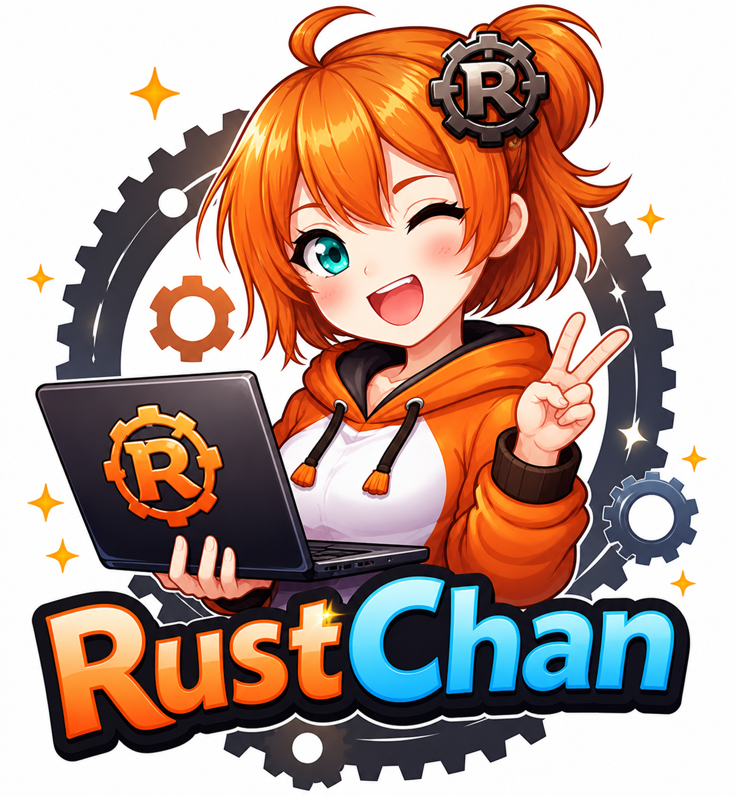
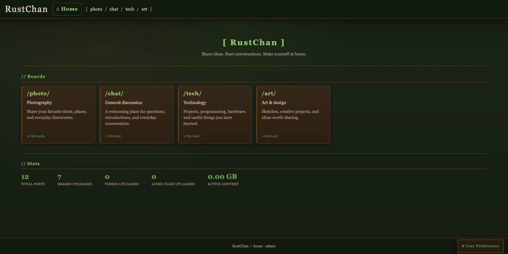
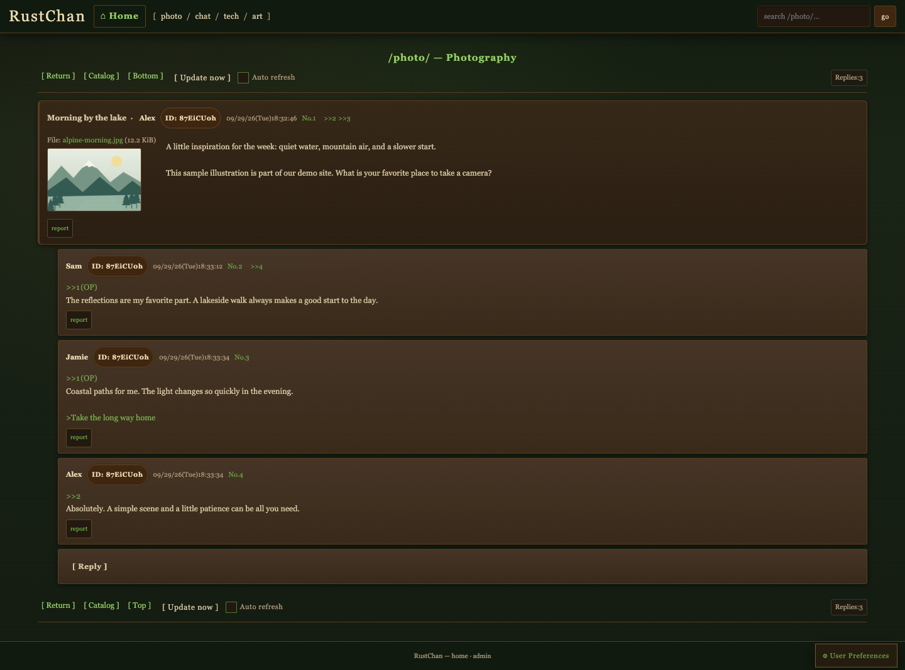
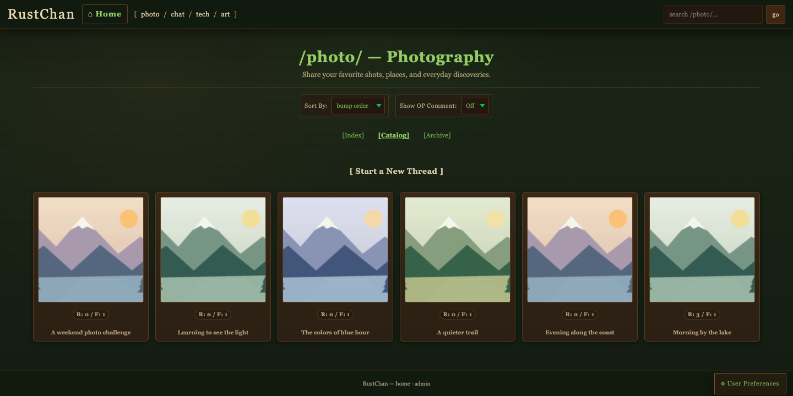
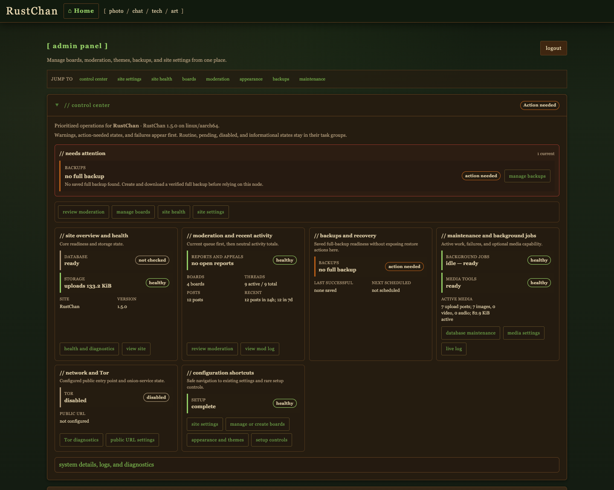
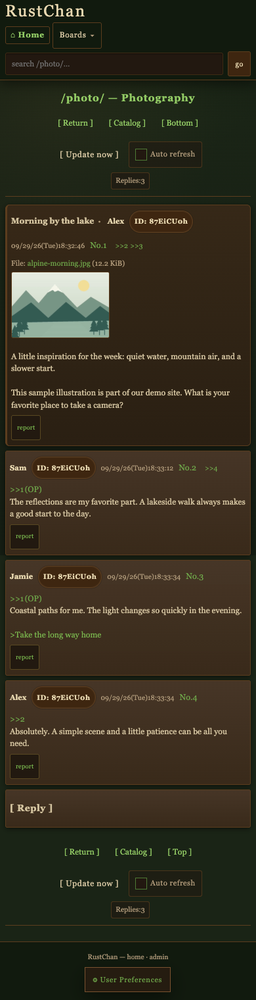

<div align="center">



# RustChan

**Your own place for image-based conversations.**

[](https://github.com/csd113/RustChan/actions/workflows/ci.yml)

[Get started](#quick-start) · [Screenshots](#screenshots) · [Features](#features) · [Guides](#documentation)

</div>

RustChan is a free app for running your own discussion website. People choose a
**board** (a topic), start **threads** (conversations), and reply with text,
pictures, or other media. You manage the site in your browser.

You run RustChan on your computer or server. It includes its own database and
website files, so you do not need a separate database, Rust, or Docker to use a
downloaded copy.

## Quick start

### 1. Download the app

Open the [official releases page](https://github.com/csd113/RustChan/releases/latest)
and expand **Assets**. Download the ZIP for your computer, then extract it to a
folder you can write to. Choose an app ZIP, not GitHub's **Source code** archive.

The published v1.7.5 downloads are:

| Your computer | ZIP filename |
| --- | --- |
| Windows, Intel or AMD 64-bit | `rustchan-cli-v1.7.5-windows-x86_64.zip` |
| Mac with an Apple chip, such as M1 or later | `rustchan-cli-v1.7.5-macos-apple-silicon.zip` |
| Mac with an Intel processor | `rustchan-cli-v1.7.5-macos-intel.zip` |
| Linux, Intel or AMD 64-bit | `rustchan-cli-v1.7.5-linux-x86_64.zip` |
| Linux, ARM64 | `rustchan-cli-v1.7.5-linux-arm64.zip` |

Linux v1.7.5 binaries require **glibc 2.39 or newer**, as provided by Ubuntu
24.04. For another environment, see [requirements and alternatives](SETUP.md#requirements).
The [setup guide](SETUP.md#check-the-download) also explains how to verify the ZIP.

### 2. Run it

Open a terminal in the extracted folder that contains `rustchan-cli` (or
`rustchan-cli.exe` on Windows). A terminal is the app where you enter commands.

For a first local trial, these commands keep the site on your own computer and
turn off Tor. Use them each time you start this trial.

**Windows — PowerShell:**

```powershell
$env:CHAN_HOST = "127.0.0.1"
$env:CHAN_TOR_SUPPORT = "false"
.\rustchan-cli.exe
```

**macOS or Linux — Terminal:**

```sh
chmod +x rustchan-cli
CHAN_HOST=127.0.0.1 CHAN_TOR_SUPPORT=false ./rustchan-cli
```

Follow the terminal prompts to create an administrator account. Choose **yes**
when asked to create a first board, then enter its short name and title.
Keep the app running while you use the site.

### 3. Open your site

Open **<http://localhost:8080>** in a browser on the same computer. Choose your
board and start a thread. Sign in at **<http://localhost:8080/admin>** with the
administrator account you just created to change the site name, add boards, or
manage posts.

If the app starts without asking for an account, open
**<http://localhost:8080/setup>**. On a fresh site, choose **Local/testing → load
defaults**, enter the site name, administrator details, and first board, then
select **review setup** and **finish setup**. This page closes once an
administrator exists. See [first-run help](SETUP.md#finish-setup) if you get stuck.

### 4. Keep your data

RustChan creates a **`rustchan-data`** folder beside the executable. It contains
your posts, uploads, settings, and other site data. Keep the whole folder when
you move or update the app. Press **Ctrl-C** in the terminal and wait for the app
to exit to stop the site; run the same command to start it again.

The app works without FFmpeg. Install it later if you want video processing or
additional audio previews; [setup instructions](SETUP.md#install-ffmpeg) explain how.
For a public website, follow the [deployment guide](docs/deployment.md) after setup.

Prefer another installation method? Use [Docker](docs/containers.md) or
[build from source](CONTRIBUTING.md#build-and-run).

## Screenshots

Captured from the published v1.5.0 Docker image, these views show a demonstration site with sample conversations and original sample artwork, using the default Forest theme.

**Home page — choose a board and see what is happening.**

<p align="center">
  
</p>

**A conversation — read replies, share media, and quote other posts.**

<p align="center">
  
</p>

<details>
<summary>See the catalog, admin panel, and phone view</summary>

**Catalog — browse a board's conversations as cards.**

<p align="center">
  
</p>

**Admin panel — manage boards, settings, moderation, and backups.**

<p align="center">
  
</p>

**Phone view — the same conversation on a smaller screen.**

<p align="center">
  
</p>

</details>

## Features

| For visitors | For site owners |
| --- | --- |
| Boards, threads, replies, search, and a visual catalog | Create boards and choose who can view or post |
| Pictures, video, audio, and optional PDF or other files | Choose upload types and limits for each board |
| Quotes, polls, spoilers, and archived conversations | Review reports, manage bans and appeals, and moderate posts |
| Themes and layouts for phones and computers | Change themes, banners, favicon, and site appearance |
| Core browsing and posting without JavaScript | Save and restore backups; schedule automatic backups |
| Optional Tor onion access | Built-in Tor hosting, optional HTTPS, and health information |

Uploads depend on site and board settings. See [media support](docs/media-capabilities.md)
for supported formats and preview limits.

## Documentation

Start with the setup guide. The other guides cover tasks you may need later.
If you are reading the README included in a ZIP, open the
[online guide list](https://github.com/csd113/RustChan#documentation) for these links.

| I want to… | Guide |
| --- | --- |
| Download, run, or troubleshoot my first site | [Setup](SETUP.md) |
| Manage boards, appearance, accounts, or the terminal console | [Administration](docs/administration.md) |
| Change settings and know when to restart | [Settings](docs/settings-restarts.md) |
| Make the site available to other people | [Deployment: service, HTTPS, proxy, Tor](docs/deployment.md) |
| Use Docker or Compose | [Containers](docs/containers.md) |
| Save or recover my site | [Backups](docs/backups.md) |
| Install a newer version | [Software updates](docs/software-updates.md) |
| Understand supported uploads | [Media capabilities](docs/media-capabilities.md) |
| Diagnose or work on the database | [SQLite guide](docs/sqlite-engineering.md) |
| Build or contribute to RustChan | [Contributing](CONTRIBUTING.md) |
| Get help or report a problem | [Support](SUPPORT.md) · [Security](SECURITY.md) |
| Read project policies and history | [Code of Conduct](CODE_OF_CONDUCT.md) · [Changelog](CHANGELOG.md) · [MIT license](LICENSE) |

These guides describe this checkout. The [changelog](CHANGELOG.md) separates
unreleased work from published releases; a download may not include every feature
shown here. The package version is currently 1.7.5.
